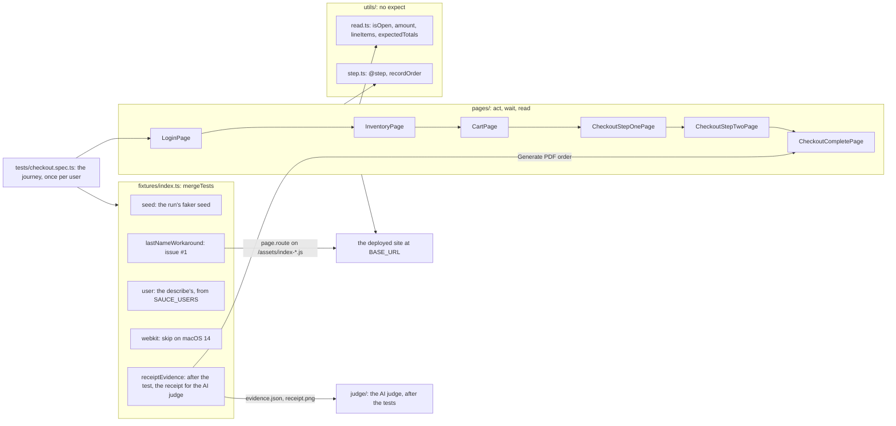
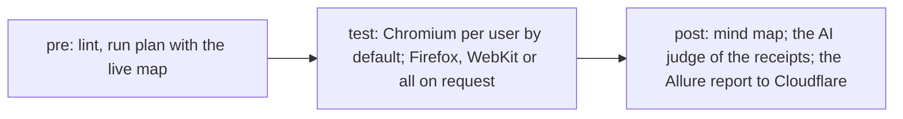

# Architecture

How the parts of the suite connect, and what each depends on. The reasons are
in the [ADRs](adr/README.md).

## A test at run time

The spec holds every assertion and chains the page objects, each action
returning the next page (ADR 0002). The fixtures cut across: the seed (ADR
0006), WebKit's skip (ADR 0004), the user (ADR 0016), the #1 workaround
(ADR 0013) and the receipt the AI judge reads (ADR 0020).

## Where the code meets the outside

| Our part | Depends on | Breaks when | Record |
| --- | --- | --- | --- |
| `isOpen()` and the locators of `pages/` | the URL, roles and names, `data-test` ids | the app renames them | ADR 0002 |
| The `lastNameWorkaround` patch and its refusal guard | the minified Last Name handler in `/assets/index-<hash>.js`, the step-one banner's `role="alert"` | a new build changes the handler or the role: the guard stops the test with its own message | ADR 0013 |
| `KNOWN` and the verdict | the exact failure messages of the spec | an `expect` message changes without `KNOWN` | ADR 0018 |
| `receiptEvidence`, `judge/checklist.mjs` and `judge/signatures.mjs` | the receipt PDF's text and layout, unpdf, `@napi-rs/canvas` | the receipt changes: the golden set and the signatures follow | ADR 0020 |
| The AI judge | OpenRouter's Decisions API, `typesafe/jev-1.14`, the `OPENROUTER_API_KEY` secret | the API's format or Jev changes, the key or the balance runs out: exit 2 | ADR 0020 |

## The pipeline

Each test job runs in the Playwright image of the pinned version, fails when
a test fails, and ends with its verdict: whether every failure is a known one
of its user (ADR 0018). The run plan (ADR 0010) and the
reports (ADR 0011) are published at `run-<number>.<project>.pages.dev`. Runs
are manual only (ADR 0009).

## The harness around it

A serious change goes `sdet` → probe run → one `critic` round → PR; a red
verdict goes to `triage`. Hooks format and lint every edited file and block
pushes to `main`. [CLAUDE.md](../CLAUDE.md) holds the rules.
